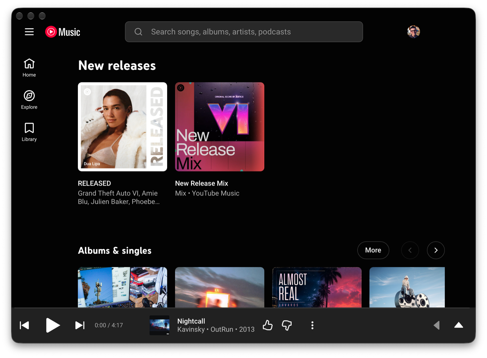

# ytm-mac

A tiny native macOS wrapper for the YouTube Music web app: a dedicated browser window for the player, turned into a proper Mac app.

<p align="center"></p>

Most desktop wrappers bundle a whole copy of Chromium through Electron. ytm-mac uses the WebKit engine built into macOS, so the download is about 500 KB rather than 150 MB, and the app is a few hundred lines of Swift and JavaScript.

## Features

- **Sign in once**: on first launch, pick a browser you already use (Safari, Firefox, Chrome or another Chromium-based browser) and the app copies its login, so there's no password or two-factor prompt. Cookies are read with Peter Steinberger's [SweetCookieKit](https://github.com/steipete/SweetCookieKit). Chromium browsers show one Keychain prompt; choose **Always Allow** so it only asks once. To switch accounts later, use **Import Login from Browser…** in the app menu.
- **Background playback**: closing the window keeps the music playing. Click the Dock icon to bring it back, and press ⌘Q to quit. Playback isn't throttled while the window is hidden.
- **Native controls**: media keys, AirPods and headphone controls, and Now Playing in Control Center and the menu bar, with artwork and scrubbing.
- **Feels like a Mac app**: the window has no visible title bar; drag it by the empty part of the player's top bar. Scrollbars are hidden, outside links open in your default browser, and a persistent cache keeps relaunches fast.

| Shortcut | Action |
|---|---|
| Space | Play / pause |
| ⌘← / ⌘→ | Previous / next track |
| ⌘↑ / ⌘↓ | Volume |
| ⌘, | Settings |
| ⌘R | Reload |
| ⌘W | Close window (keeps playing) |

## Install

```sh
brew install --cask danielsinclair/tap/ytm-mac
```

Or download a zip from [Releases](https://github.com/DanielSinclair/ytm-mac/releases): `arm64` for Apple silicon, `universal` for Intel. Requires macOS 14 or later.

To uninstall, including the app's cookies and cache:

```sh
brew uninstall --zap --cask ytm-mac
```

## Privacy

ytm-mac has no servers, analytics or telemetry. Imported cookies are read on your Mac and stored only in the app's own WebKit storage. The app never sees your password.

## Disclaimer

> [!IMPORTANT]
> **No affiliation.** ytm-mac is an independent, unofficial, non-commercial project. It is not affiliated with, authorized by, endorsed by or in any way officially connected with Google LLC, YouTube, YouTube Music or any of their subsidiaries or affiliates.
>
> **How it works.** The app displays the official YouTube Music website (music.youtube.com) in a native window, without modifying its content or bypassing ads, subscriptions or other restrictions. Each user signs in with their own account and is bound by YouTube's Terms of Service. Premium features such as ad-free listening still require a YouTube Music Premium subscription.
>
> **Trademarks.** "YouTube", "YouTube Music" and related names, marks, emblems and images are trademarks of Google LLC. They are used here only to identify the service, and their use implies no association with or endorsement by the trademark holder.
>
> **No warranty.** Provided "as is" under the MIT License, without warranty of any kind. Use at your own risk.
